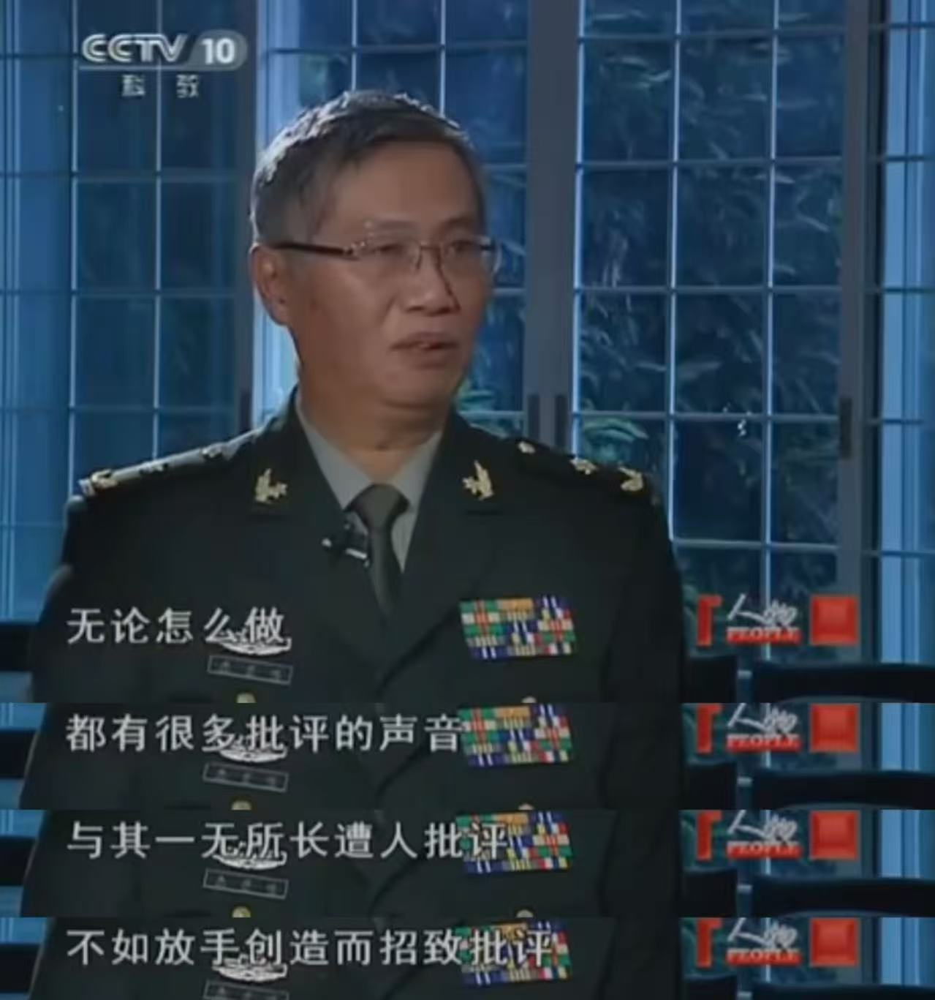

## 🎯 Projects

### 🎨 Real-Time Rendering

<table>
  <tr><th width="160" align="left">Project</th><th width="420" align="left">Description</th><th width="180" align="left">Stack</th></tr>
  <tr>
    <td width="160"><b><a href="https://github.com/CarlottaSeal/LuminaGI">LuminaGI</a></b></td>
    <td width="420">Lumen-style real-time global illumination: surface cache, radiosity, screen-space radiance probes and voxel lighting. SMU Guildhall thesis.</td>
    <td width="180">  </td>
  </tr>
  <tr>
    <td width="160"><b><a href="https://github.com/CarlottaSeal/IglooEngine">IglooEngine</a></b></td>
    <td width="420">Custom DX12 rendering engine with a 12-step render pipeline, compute pipeline and job system. The foundation LuminaGI runs on.</td>
    <td width="180">  </td>
  </tr>
  <tr>
    <td width="160"><b><a href="https://github.com/CarlottaSeal/VulkanRTTest">VulkanRTTest</a></b></td>
    <td width="420">Vulkan KHR ray tracing on Crytek Sponza. ReSTIR DI (Bitterli 2020) with visibility-aware <code>pHat</code> via inline ray queries, plus an SVGF denoiser.</td>
    <td width="180">  </td>
  </tr>
  <tr>
    <td width="160"><b><a href="https://github.com/CarlottaSeal/RedCraft">RedCraft</a></b></td>
    <td width="420">Minecraft-style procedural voxel world generation with terrain algorithms, chunk management and real-time rendering.</td>
    <td width="180"></td>
  </tr>
</table>

### 🤖 Robotics Simulation

<table>
  <tr><th width="160" align="left">Project</th><th width="420" align="left">Description</th><th width="180" align="left">Stack</th></tr>
  <tr>
    <td width="160"><b><a href="https://github.com/CarlottaSeal/visual-dr-manipulation">visual-dr-manipulation</a></b> </td>
    <td width="420">Which visual randomization actually transfers? Ablation of five DR axes (lighting, material, camera, post-processing, scene geometry) for a vision-based Franka Lift policy, distilled from a state PPO teacher. Each axis maps to a real render-pipeline stage.</td>
    <td width="180">  </td>
  </tr>
</table>

### ⚡ GPU Compute & AI Kernels

<table>
  <tr><th width="160" align="left">Project</th><th width="420" align="left">Description</th><th width="180" align="left">Stack</th></tr>
  <tr>
    <td width="160"><b><a href="https://github.com/CarlottaSeal/FlashAttention-lite">FlashAttention-lite</a></b></td>
    <td width="420">CUDA FlashAttention from scratch in six profiling-driven versions (naive → wmma → <code>mma.sync</code> + register-resident S/P/O + XOR swizzle shmem), plus a Triton port with multi-head, causal and backward pass. Validated on Ada and Blackwell.</td>
    <td width="180">  </td>
  </tr>
  <tr>
    <td width="160"><b><a href="https://github.com/CarlottaSeal/llama-cuda-inference">llama-cuda-inference</a></b></td>
    <td width="420">CUDA inference engine for Llama 3.2 1B — every kernel hand-written, no cuBLAS/cuDNN. GEMM (naive → tiled → wmma Tensor Cores), FlashAttention, RMSNorm, RoPE, SiLU×Mul. Greedy output matches HF transformers token-for-token.</td>
    <td width="180"> </td>
  </tr>
  <tr>
    <td width="160"><b><a href="https://github.com/CarlottaSeal/vulkan-gemm">vulkan-gemm</a></b></td>
    <td width="420">FP32 SGEMM as Vulkan compute shaders, one optimization per kernel (naive → smem tiling → vec4 register blocking → subgroup shuffle), benchmarked against cuBLAS.</td>
    <td width="180">  </td>
  </tr>
  <tr>
    <td width="160"><b><a href="https://github.com/CarlottaSeal/neural-rendering-cuda">neural-rendering-cuda</a></b></td>
    <td width="420">GPU kernel work on neural rendering: 3DGS rasterizer optimization (<b>1.7× training speedup</b>, PSNR within 0.03 dB), Instant-NGP from scratch (hash encoding <b>12.6× faster</b> than PyTorch reference), and a differentiable soft rasterizer.</td>
    <td width="180">  </td>
  </tr>
  <tr>
    <td width="160"><b><a href="https://github.com/CarlottaSeal/LuminaGI-CudaRef">LuminaGI-CudaRef</a></b></td>
    <td width="420">CUDA path tracer (LBVH, NEE, Russian roulette) as ground truth for LuminaGI. PyTorch U-Net denoiser on 8-spp output, <b>22× faster than 256-spp at 80% of its PSNR gain</b>.</td>
    <td width="180">  </td>
  </tr>
</table>

### 🧪 Graphics Testing

<table>
  <tr><th width="160" align="left">Project</th><th width="420" align="left">Description</th><th width="180" align="left">Stack</th></tr>
  <tr>
    <td width="160"><b><a href="https://github.com/CarlottaSeal/GfxTestKit">GfxTestKit</a></b></td>
    <td width="420">Config-driven test runner for graphics apps: screenshot diff (PSNR/SSIM), shader compilation tests, memory leak detection, benchmark regression and sanitizer parsing.</td>
    <td width="180"> </td>
  </tr>
</table>

### 🗺️ Next

- **Triton compiler contributions**: bug fixes, benchmarks and backend optimizations in C++/MLIR

---

## 🛠️ Tech Stack

| | |
|:--|:--|
| **Languages** |       |
| **GPU** |     |
| **Profiling** |     |
| **Tools** |     |
| **Testing** |    |

---

  

